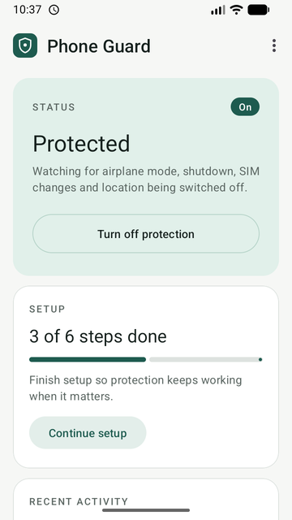
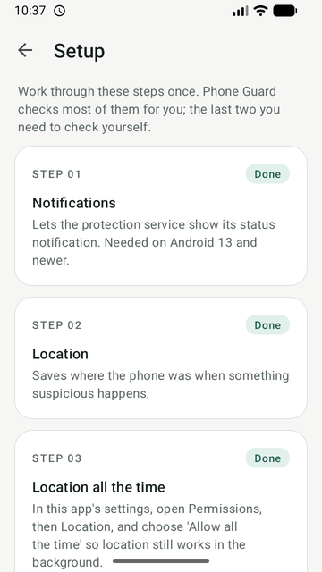
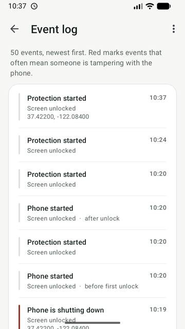
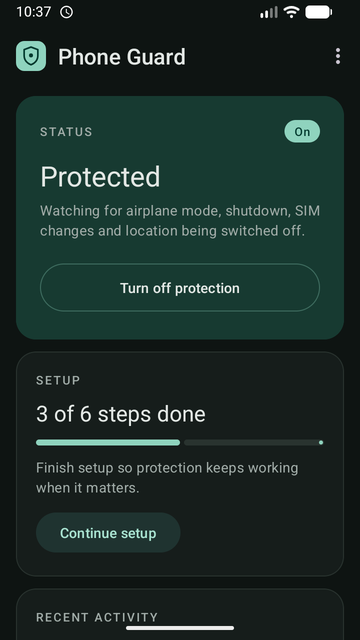

# Phone Guard

Final year project (IMCA): an Android app that helps the owner get a stolen phone back, even when the thief turns on airplane mode, powers off, removes the SIM or resets the phone.

**Status: phase 1 (event recorder). Works on the Android emulator. Not yet tested on a real phone.**

<p>
  
  
  
  
</p>

## The honest goal

A normal Android app cannot stop a real power-off, survive a factory reset, or track a phone with no working radio. So this project does not promise guaranteed recovery. It aims to:

- shrink the thief's window,
- record as much evidence as possible (what happened, when, where),
- make the phone hard to use,
- help the owner act fast (police report and IMEI block).

## What phase 1 does

- A foreground service records these events with the time, whether the screen was locked, and the last known location:
  airplane mode on/off, shutdown, phone start (before and after first unlock), SIM removed or changed, location turned off/on, wrong unlock attempts, device admin turned on/off.
- Events are stored in a local log on the phone (last 500 kept).
- Protection restarts by itself after the phone starts, before the first unlock, if it was switched on.
- Nothing is uploaded yet. See [docs/ROADMAP.md](docs/ROADMAP.md) for the next phases (server upload, heartbeat alerts, fake switch-off, intruder selfie, recovery assistant).

## The app

| Screen | What it shows |
|---|---|
| Home | Protection status with one button to turn it on or off (turning off asks first), setup progress, and the three latest events |
| Setup | Eight steps, each marked **Done**, **To do** or **Check yourself**. The app checks six of them itself; each step's button opens the right system screen |
| Event log | Every event, newest first. Red marks events that often mean tampering (airplane mode on, shutdown, SIM removed, location off, wrong PIN, admin removed). **Share log** sends it as text, for example to the police; **Clear log** asks before deleting |
| About | Version, what the app does, privacy and honest limits |

Light and dark mode follow the phone's setting. The logo is a shield outline with a dot, drawn as a vector and used for the launcher icon (including Android's themed icons), the splash screen and the in-app badge.

## Build and run

You need Android Studio. It includes the Android SDK and a JDK, so nothing else has to be installed.

1. Open this folder in Android Studio and let Gradle sync. Android Studio writes `local.properties` with the SDK path; that file stays out of git.
2. Run the `app` configuration on a phone or emulator with Android 8.0 (API 26) or newer.
3. Open the app, work through **Setup**, then tap **Turn on protection**.

From the command line (PowerShell, in the project folder):

```
.\gradlew :app:assembleDebug        # build the APK into app/build/outputs/apk/debug/
.\gradlew :app:installDebug         # install on a connected phone or running emulator
.\gradlew :app:testDebugUnitTest    # unit tests (event log encoding, runs on a normal JVM)
```

If Gradle cannot find Java, point `JAVA_HOME` at Android Studio's bundled JDK (`C:\Program Files\Android\Android Studio\jbr`). If it cannot find the SDK, create `local.properties` with `sdk.dir=C:/Users/<you>/AppData/Local/Android/Sdk`.

## Test results so far

Tested on the Android emulator (Android 17, API 37) on 27 Nov 2026. **These still need to be repeated on real phones**, especially ones from makers with aggressive battery management (for example ColorOS).

| Trigger | Emulator result |
|---|---|
| Airplane mode on/off, screen unlocked | Recorded, with location |
| Airplane mode on/off, screen locked | Recorded, marked "screen locked" |
| Location turned off/on | Recorded |
| Normal restart | "Phone is shutting down", then "Phone started" before and after the first unlock |
| Forced restart (`adb reboot`) | No shutdown event (expected: Android skips its normal shutdown) |
| Protection after a restart | Restarts by itself before the first unlock |
| Airplane mode before the first unlock | Recorded |
| Force stop or app update | Protection comes back; no fake "Phone started" event (see below) |

Not testable on the emulator: SIM removal, wrong-PIN counting through device admin, and the phone maker stopping the service.

**Found while testing:** Android 15 and newer send the boot broadcasts again when an app leaves the "stopped" state (after a force stop or an update). The app now records "Phone started" only once per real restart, using the system boot counter, but still restarts the service every time.

## Permissions and why

| Permission | Why |
|---|---|
| Location (fine, coarse, background) | Save where the phone was when something suspicious happens |
| Foreground service (special use) and notifications | Keep the watcher running and visible |
| Receive boot completed | Restart protection after the phone starts |
| Device admin (watch-login) | Harder to uninstall and see wrong-PIN attempts |

## Privacy

- Events stay on the phone in this phase. Location is only the last location the phone already knew, so events right after a restart may have none.
- The log is kept in device-protected storage so events can be saved before the first unlock after a restart. That storage is less protected than normal app storage, so the log should not hold anything more sensitive than event types, times and coordinates.
- **Share log** only sends the log when the owner chooses where to send it.
- Use this app only on your own phone.

## Known limits of phase 1

- Turning protection off asks for confirmation but has no PIN or biometric check yet, so anyone holding the unlocked phone can switch it off.
- SIM monitoring handles the simple case (one SIM state), not dual-SIM details.
- All tests so far ran on the emulator. Real-phone behaviour, especially the shutdown broadcast and the phone maker stopping the service, is unverified.
- The ColorOS setting "Allow Quick Settings on Lock screen" can only be changed by the user; the app guides them to settings.

## Project layout

```
app/src/main/java/com/phoneguard/
  GuardService.kt        foreground service, listens for system events
  BootReceiver.kt        restarts protection after boot, records real restarts once
  GuardAdminReceiver.kt  device admin: wrong PIN, admin on/off
  EventRecorder.kt       creates and saves every event
  EventLog.kt            event log file in device-protected storage
  EventCodec.kt          event <-> text line (no Android classes, unit tested)
  MainActivity.kt        home screen
  SetupActivity.kt       setup checklist; steps and their checks in SetupSteps.kt
  LogActivity.kt         full event log, share and clear
  AboutActivity.kt       about screen
app/src/main/res/        layouts, theme, colours (values-night for dark mode), logo
docs/                    roadmap and screenshots
```

## Research

The research behind this project (thief behaviour, competing apps, Android limits, pros and cons) is in the Word document "Anti-Theft App - Research Notes" kept with the project files.
